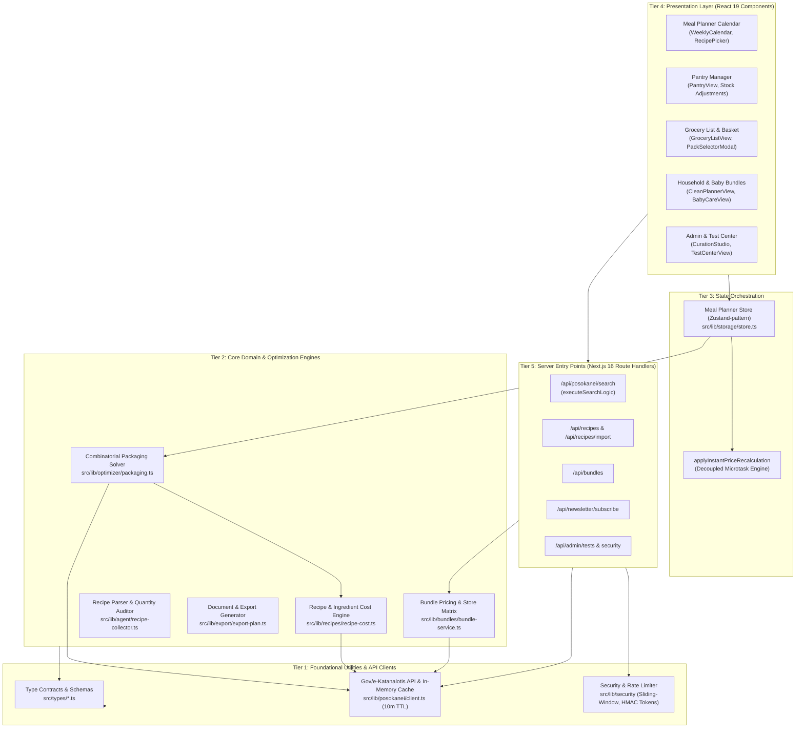

# System Architecture & Technical Specifications

> **Application**: `pioftina.gr` (Smart Meal Planning & Greek Supermarket Price Optimization)  
> **Framework**: Next.js 16 (App Router), React 19, TypeScript 5, Tailwind CSS 4, Supabase  
> **Architecture Analysis**: Extracted via AST graph traversal (`@sdsrs/code-graph`)

---

## 1. High-Level Architecture Topology

The application is structured into five distinct architectural tiers: **Foundational Utility/Types**, **Core Computation Engines**, **Reactive State Orchestration**, **UI Feature Components**, and **Next.js Server API Routes**.



---

## 2. Core Modules Breakdown

| Module | Location | Primary Responsibilities & Key Exports |
|---|---|---|
| **Domain Schemas & Types** | `src/types/` | Data contracts: `Recipe`, `Ingredient`, `ProductBundle`, `SupermarketName`, `OptimizedGroceryList`, `BasketComparison`. Single source of truth. |
| **Supermarket Pricing Client & Cache** | `src/lib/posokanei/` | Connects to `posokane.gov.gr` (e-Katanalotis). Contains `searchProducts`, `getProductById`, retailer mapping, and a 10-minute sliding-window memory cache (`getCachedSearch`, `setCachedSearch`) to prevent 429 rate limit errors. |
| **Packaging & Basket Optimizer** | `src/lib/optimizer/` | `generateOptimizedGroceryList`, `computeBasketComparisons`, `evaluatePackOptions`. Performs unit conversion ($g \leftrightarrow kg$, $ml \leftrightarrow L$), multi-pack synthesis, and price comparisons across Sklavenitis, AB, Masoutis, Kritikos, Chalkiadakis. |
| **Reactive Store & Sync** | `src/lib/storage/` | `useMealPlannerStore`, `applyInstantPriceRecalculation`. Manages meal slots (Mon-Sun), pantry items, and auto-deduplication. Uses microtask queueing to guarantee 60fps UI responsiveness without layout reflows. |
| **Recipe Cost Engine** | `src/lib/recipes/` | `calculateRecipeCost`, `calculateIngredientCost`, curated seed database (`RAW_SEED_RECIPES`, 80 curated Greek recipes across Breakfast, Lunch, Dinner, Snack). |
| **Household & Baby Bundles** | `src/lib/bundles/` | Pre-configured grocery packs (Cleaning, Family Laundry, Baby Care, New Born). Handles supermarket matrix pricing and server sync. |
| **Recipe Agent & NLP Parser** | `src/lib/agent/` | Parses raw ingredient strings (`parseIngredientLine`), audits volumetric quantities (`auditIngredient`), and detects categories. |
| **Security & Authentication** | `src/lib/security/` | `checkRateLimit` (IP sliding-window limiter), `verifyAdminRequest`, `createAdminToken` (cryptographic HMAC-SHA256 session management). |
| **Export Engine** | `src/lib/export/` | Formats meal plan and grocery list into print-ready A4 HTML (`generatePlanAndShoppingListHtml`), plaintext (`.txt`), and portable JSON backups. |
| **Automated Testing & Pentest** | `src/tests/` | 46 integration/unit tests across 9 suites and 32 OWASP ASVS penetration audit rules (`npm test`, `npm run pentest`). |

---

## 3. Structural Chokepoints (Betweenness Centrality Analysis)

The following functions have the highest betweenness centrality score across the codebase call graph. They serve as structural bridges connecting multiple subsystems; any modifications to these functions require careful regression testing.

| Rank | Chokepoint Symbol | Location | Centrality | Inbound Callers | Blast Radius & Architectural Role |
|:---:|---|---|:---:|:---:|---|
| **1** | `executeSearchLogic` | `src/app/api/posokanei/search/route.ts` | **22.0** | 2 routes | Gateway between Next.js HTTP routes and the external Posokanei API client. Handles parameter validation, error sanitization, and fallback orchestration. |
| **2** | `checkRateLimit` | `src/lib/security/rate-limiter.ts` | **20.0** | 8 callers | Security boundary protecting all public POST/GET routes and external API proxying. Prevents DoS and IP throttling. |
| **3** | `applyInstantPriceRecalculation` | `src/lib/storage/store.ts` | **16.0** | 8 callers | The central state calculation bridge. Triggers whenever meal slots, pantry stock, pack selections, or supermarket preferences change. |
| **4** | `verifyAdminRequest` | `src/lib/security/admin-auth.ts` | **14.0** | 7 callers | Access control gate protecting recipe mutations, bundle modifications, and test suite triggering. |
| **5** | `parseIngredientLine` | `src/lib/agent/recipe-collector.ts` | **12.0** | 2 callers | NLP tokenizer converting free-form recipe strings into structured `{ name, amount, unit }` objects. |
| **6** | `searchProducts` | `src/lib/posokanei/client.ts` | **12.0** | 2 callers | Core supermarket data fetcher. Intercepts queries, queries the 10-minute in-memory cache, and handles HTTP fallback mechanisms. |
| **7** | `generateOptimizedGroceryList` | `src/lib/optimizer/packaging.ts` | **8.0** | 1 caller | Mathematical core: aggregates common ingredients, subtracts pantry inventory, finds optimal pack sizes, and computes cheapest retailer. |
| **8** | `parseRawRecipeText` | `src/lib/agent/recipe-collector.ts` | **5.0** | 2 callers | Higher-order agent function parsing full recipes from web imports or text prompts into structured meal records. |
| **9** | `calculateIngredientCost` | `src/lib/recipes/recipe-cost.ts` | **2.0** | 1 caller | Determines individual ingredient costs based on curated supermarket SKU unit prices. |

---

## 4. End-to-End Data Flow

```mermaid
sequenceDiagram
    autonumber
    actor User as User
    participant UI as Meal Planner / Pantry UI
    participant Store as useMealPlannerStore
    participant Opt as Packaging Optimizer
    participant Cache as Posokanei Search Cache
    participant Ext as posokane.gov.gr API

    User->>UI: Selects recipe for Monday Lunch
    UI->>Store: addMealToSlot("mon", "lunch", recipeId)
    Store->>Opt: aggregateIngredients(selectedMeals)
    Store->>Store: Subtract items marked in Pantry (home stock)
    Store->>Opt: generateOptimizedGroceryList(remainingRequirements)
    Opt->>Cache: Fetch current SKU prices (Sklavenitis, AB, etc.)
    alt Cache Miss
        Cache->>Ext: HTTP GET /api/v1/products/search?q=...
        Ext-->>Cache: Supermarket price points
        Cache-->>Opt: Normalized daily prices
    else Cache Hit
        Cache-->>Opt: In-memory cached product page (10m TTL)
    end
    Opt->>Opt: Compute lowest cost retailer & multi-pack options
    Opt-->>Store: Return OptimizedGroceryList & BasketComparisons
    Store->>UI: Reactive state update (queueMicrotask)
    UI-->>User: Instant update of Grocery List & Store Comparison Matrix
```

### Key Phases:
1. **User Action & Plan Composition**: The user assigns recipes to weekly calendar slots or adds curated cleaning/baby bundles.
2. **Pantry Inventory Deduplication**: Ingredients already available at home (marked via Pantry or the *"Έχω ήδη στο σπίτι"* button) are deducted from required quantities.
3. **Packaging Optimization**: Unit normalization reconciles incompatible units (e.g., $250g$ flour + $1kg$ flour $\to 1.25kg$). Multi-pack evaluator tests available package sizes ($500g$, $1kg$, $5kg$) to minimize both surplus waste and price per unit.
4. **Multi-Retailer Comparison**: Total baskets are computed concurrently across major Greek supermarket chains (**Σκλαβενίτης**, **ΑΒ Βασιλόπουλος**, **Μασούτης**, **Κρητικός**, **Χαλκιαδάκης**) highlighting the cheapest option and potential savings.
5. **Decoupled Reactive Render**: Changes in state trigger `applyInstantPriceRecalculation` wrapped in `queueMicrotask` to prevent layout reflows and guarantee smooth 60fps animations.
6. **Export & Persistence**: The finalized list can be exported locally to printable HTML, raw TXT, or JSON without requiring an account.

---

## 5. Engineer Reading Order (Topological Tour)

For engineers joining the project, follow this dependency-ordered reading path derived from module centrality and import chains:

### Phase 1: Foundations & Utility Contracts (Start Here)
1. **`src/types/index.ts`** & **`src/types/bundles.ts`**: Understand the primary data domain models (`Recipe`, `Ingredient`, `ProductBundle`, `DailyPrice`).
2. **`src/lib/security/rate-limiter.ts`** & **`admin-auth.ts`**: Review request throttling and session signing mechanics.
3. **`src/lib/posokanei/client.ts`** & **`search-cache.ts`**: Learn how external supermarket data is fetched, normalized, and cached.

### Phase 2: Domain Logic & Optimization
4. **`src/lib/recipes/recipe-cost.ts`** & **`src/lib/recipes/data/`**: Examine how ingredient prices are calculated and seeded.
5. **`src/lib/optimizer/packaging.ts`**: Study the combinatorial pack optimizer, unit converters, and supermarket comparison algorithms.
6. **`src/lib/bundles/bundle-service.ts`**: Review the pre-configured household and baby bundle logic.
7. **`src/lib/agent/recipe-collector.ts`**: Inspect regex and NLP parsing for Greek ingredient strings.

### Phase 3: State Orchestration
8. **`src/lib/storage/store.ts`**: Core application state. Trace how `useMealPlannerStore` binds slots, pantry stock, and triggers `applyInstantPriceRecalculation`.

### Phase 4: UI Components
9. **`src/components/ui/`** & **`src/components/layout/main-header.tsx`**: Design system tokens and top-level navigation.
10. **`src/components/meal-planner/weekly-calendar.tsx`** & **`recipe-picker.tsx`**: Weekly meal planning interface.
11. **`src/components/pantry/pantry-view.tsx`**: Inventory and surplus tracker.
12. **`src/components/grocery-list/grocery-list-view.tsx`**: Shopping list, store comparison widget, and pack selector modal.
13. **`src/components/bundles/`**: Clean Planner and Baby Care view implementations.
14. **`src/components/admin/`**: Recipe curation studio, bundle editor, and test center.

### Phase 5: Server Entry Points & Integration
15. **`src/app/api/posokanei/search/route.ts`**: Supermarket search gateway.
16. **`src/app/api/recipes/`**: Recipe persistence and import endpoints.
17. **`src/app/page.tsx`**: Root application shell orchestrating active view tabs.
18. **`src/tests/suites/`**: Full test runner architecture verifying all layers.
